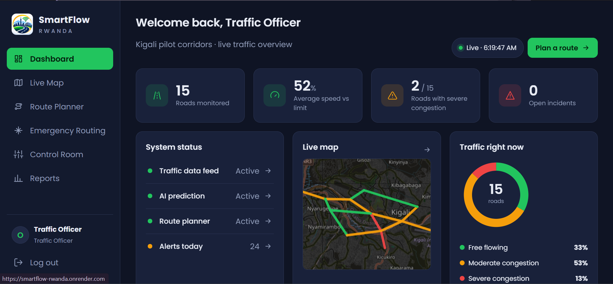
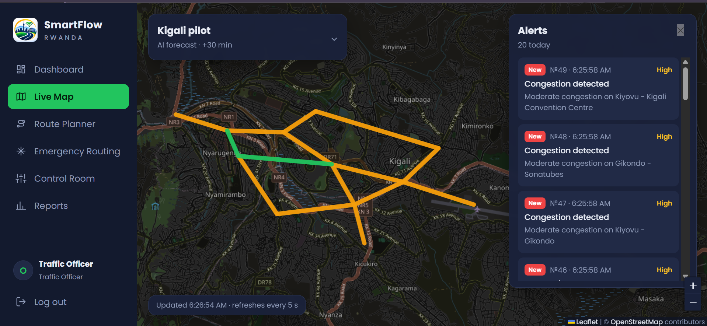
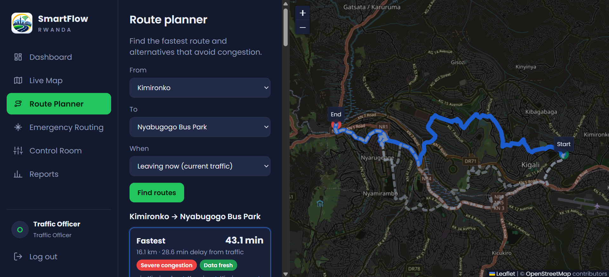
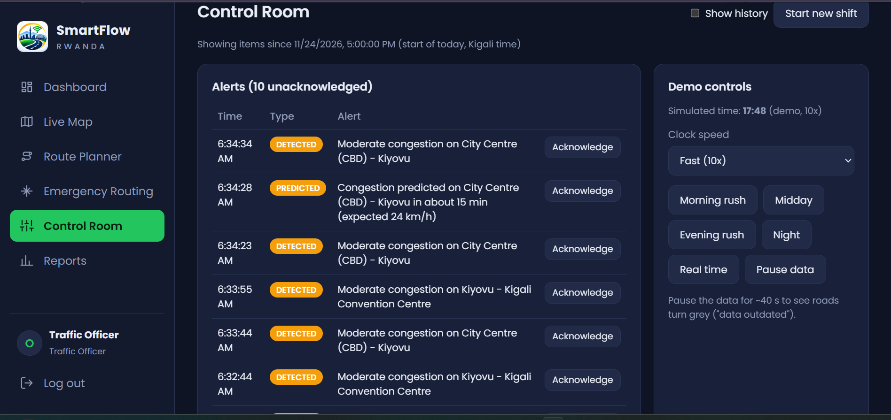
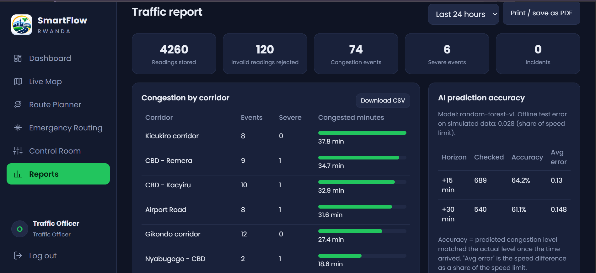
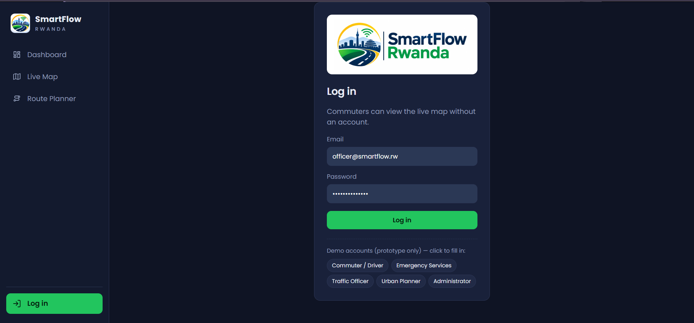

# SmartFlow Rwanda — AI-Powered Intelligent Traffic Management System

SmartFlow Rwanda monitors traffic on selected Kigali corridors, detects and **predicts** congestion with AI,
recommends alternative and emergency routes, and helps traffic officers make decisions — always keeping a human in control.

**Author:** Nyisenge Heureuse Faustine — African Leadership University
**SRS document:** [SmartFlow Rwanda SRS](https://drive.google.com/file/d/12nHB60ZhXswZ38HUXQUWKTeHCFCoznZj/view?usp=sharing)

## 🔗 Live app

**https://smartflow-rwanda.onrender.com**

> ⏳ The app runs on Render's free plan, which sleeps after about 15 minutes without visitors.
> The **first visit can take up to 1 minute** to wake it up. After that it is fast.

### Demo accounts

All accounts use the password **`SmartFlow2026!`** (the login page also has one-click buttons to fill them in).

| Role | Email | What they can do |
|---|---|---|
| Commuter / Driver | commuter@smartflow.rw | Live map, AI forecast, route planner, saved routes and alerts |
| Emergency Services | emergency@smartflow.rw | Request emergency routes (officers are notified) |
| Traffic Officer | officer@smartflow.rw | Control Room: alerts, incidents, signal recommendations, demo controls |
| Urban Planner | analyst@smartflow.rw | Traffic reports and AI accuracy |
| Administrator | admin@smartflow.rw | Users and roles, data sources, thresholds, audit log |

The live map and route planner can also be used **without logging in**.

---

## The problem

Kigali's main corridors (Nyabugogo, the City Centre, Kacyiru, Remera, Kimironko, Kicukiro) are heavily congested at peak hours.
Commuters lose time and fuel, ambulances and police are delayed, and traffic management is mostly **reactive**:
officers respond after jams form, with little data on where congestion will appear next.

## The solution

SmartFlow Rwanda collects traffic readings, validates them, detects congestion in real time and uses an AI model to
forecast congestion up to 60 minutes ahead. Commuters get routes that avoid current and predicted congestion,
emergency services get the fastest route with officers notified, and traffic officers get alerts and signal-timing
recommendations that they must approve — SmartFlow never changes traffic signals by itself.

## Features

| Feature | SRS requirements |
|---|---|
| Traffic data from GPS, sensor and camera sources every 5 seconds | FR 1, FR 1.1 |
| Validation: invalid records are rejected and logged, never used | FR 1.2 |
| Live map of 15 Kigali road segments coloured by congestion, auto-refresh | FR 2, NFR 1 |
| Congestion detection with admin-configurable thresholds | FR 3.1 |
| AI congestion prediction (random forest): Now / +15 / +30 / +60 min forecast tabs on the live map | FR 3.2 |
| Dashboard with key figures, system status, live mini map and a 60-minute AI forecast chart | FR 2, FR 7 |
| Turn-by-turn directions along real roads (OpenStreetMap / OSRM) for normal and emergency routes | FR 4, FR 6 |
| Prediction accuracy tracked against what actually happened | NFR 19 |
| Fastest and alternative routes, now or using the AI forecast; saved routes with alerts | FR 4, FR 10 |
| Emergency routing with ETA; officers are notified | FR 6 |
| Alerts for detected and predicted congestion; officers acknowledge them | FR 5.1, FR 10 |
| Signal-timing recommendations that an officer must approve or reject; unreviewed ones expire | FR 5.2, NFR 6 |
| Incident recording and status updates, shown on the map | FR 9 |
| Daily Control Room view, "Show history" and "Start new shift" | FR 5 |
| Reports by corridor and road, CSV download, print to PDF | FR 7 |
| Login for 5 roles; pages and API restricted by role; admin user management | FR 8, NFR 8, NFR 9 |
| Audit log and management-actions log | NFR 12 |
| "Data outdated" warnings on the map and on routes | NFR 7 |
| Advisory notices on travel times and routes | NFR 5 |

## Screenshots

| Dashboard | Live map with AI forecast |
|---|---|
|  |  |
| **Route planner with turn-by-turn directions** | **Control Room (traffic officer)** |
|  |  |
| **Reports (urban planner)** | **Login** |
|  |  |

## Tech stack

| Layer | Technology |
|---|---|
| Frontend | React 18, Vite, React Router, Leaflet + OpenStreetMap |
| Backend | Python 3, FastAPI, SQLModel |
| AI | scikit-learn (random forest regression), NumPy |
| Routing | Dijkstra's algorithm on the Kigali road graph, weighted by live or predicted travel time |
| Database | SQLite (prototype; can switch to PostgreSQL via `DATABASE_URL`) |
| Auth | JWT tokens with role-based access control |
| Hosting | Render (one web service serves the API and the website) |

### About the traffic data

Real-time traffic feeds for Kigali are limited, so the prototype includes a **traffic simulator** that generates realistic
readings (morning and evening rush hours, random incidents and a few broken records to test validation).
It sends data through the same pipeline a real source would use, so real sources can be added later through the
`DataSource` model. The AI model is trained on simulated traffic history, as stated in the SRS assumptions.

---

## Run it on your own computer

### 1. Install the tools (one time)

| Tool | Version | Download |
|---|---|---|
| Python | 3.10 or newer | https://www.python.org/downloads/ — on Windows, tick **"Add python.exe to PATH"** during install |
| Node.js | 18 or newer (LTS) | https://nodejs.org/ |
| Git | any | https://git-scm.com/downloads |

Check they are installed — open a terminal (on Windows: **PowerShell** or the VS Code terminal) and run:

```bash
python --version
node --version
git --version
```

Each command should print a version number.

### 2. Download the project

```bash
git clone https://github.com/fnyisenge/smartflow-rwanda.git
cd smartflow-rwanda
```

### 3. Start the backend (terminal 1)

```bash
cd backend
python -m pip install -r requirements.txt
python -m uvicorn app.main:app --reload
```

Wait until you see **`Application startup complete`** (the first start takes a few extra seconds while the AI model trains).
Leave this terminal open.

- The API runs at http://localhost:8000
- Health check: http://localhost:8000/api/health should show `{"status":"ok",...}`
- Interactive API documentation: http://localhost:8000/docs

<details>
<summary>Optional: use a virtual environment instead</summary>

```bash
cd backend
python -m venv .venv
# Windows (PowerShell):
.venv\Scripts\activate
# Mac / Linux:
source .venv/bin/activate
pip install -r requirements.txt
uvicorn app.main:app --reload
```

Creating the virtual environment can take 1–3 minutes with no output. Do not press Ctrl+C while it runs.
</details>

### 4. Start the frontend (terminal 2)

Open a **second** terminal, go to the project folder, then:

```bash
cd frontend
npm install
npm run dev
```

On **Windows PowerShell**, if you get *"running scripts is disabled on this system"*, use `npm.cmd` instead:

```powershell
npm.cmd install
npm.cmd run dev
```

### 5. Open the app

Go to **http://localhost:5173** and log in with one of the demo accounts above.

To stop the app, press **Ctrl + C** in each terminal. To start it again later, repeat steps 3 and 4
(you can skip the `pip install` and `npm install` lines).

---

## Demo guide (5 minutes)

1. Open the live app and log in as **Traffic Officer**. In the **Control Room**, set clock speed to **Fast (10x)** and click **Evening rush**.
2. After about 20 seconds, open the **Dashboard**: key figures, system status, the live mini map, the "Traffic right now" chart and the 60-minute AI forecast.
3. Open the **Live Map**: roads turn amber and red, and new alerts appear on the right. Click the **+30 min** tab to see the AI forecast, and click a road to see its speed and travel time.
4. Open the **Route Planner**: choose **Kimironko** to **Nyabugogo Bus Park** and click **Find routes**. You get the fastest route, alternatives and turn-by-turn directions along real roads. Try **In 30 min (AI forecast)**.
5. Log in as **Emergency Services**, open **Emergency Routing** and request a route. Then log in as the officer again and find it under **Emergency requests** in the Control Room.
6. In the **Control Room**: acknowledge an alert, **Approve** a signal recommendation and **Record an incident** (it appears as a red dot on the Live Map).
7. Click **Pause data** and wait about 40 seconds: roads turn grey ("Data outdated"). Then click **Resume data**.
8. Log in as **Urban Planner** and open **Reports**: congestion by corridor and AI prediction accuracy. To fill the accuracy table quickly, set clock speed to **Very fast (60x)** for a few minutes first.
9. Log in as **Administrator** and open **Admin** (users, data sources, congestion thresholds) and the **Audit Log**.

---

## Deployment (Render)

The repository includes a Render Blueprint (`render.yaml`). The backend also serves the built React website,
so the whole app runs on **one URL**.

1. Create an account at https://render.com and connect your GitHub account.
2. **New → Blueprint** → choose this repository → give it a name → **Deploy Blueprint**.
3. Render runs:
   - Build: `pip install -r backend/requirements.txt && cd frontend && npm ci && npm run build`
   - Start: `cd backend && uvicorn app.main:app --host 0.0.0.0 --port $PORT`
4. When the logs say **"Your service is live"**, open the URL shown at the top of the service page.

A random `JWT_SECRET` is generated by Render automatically. On the free plan the SQLite database resets when the
service restarts; the road network and demo accounts are recreated automatically.

---

## Troubleshooting

| Problem | Fix |
|---|---|
| `running scripts is disabled on this system` (Windows) | Use `npm.cmd` instead of `npm`, or run `Set-ExecutionPolicy -Scope CurrentUser RemoteSigned` once and answer `Y` |
| `python` is not recognized | Reinstall Python and tick **"Add python.exe to PATH"**, or try `py` instead of `python` |
| `cd backend` — cannot find path | You are in the wrong folder. Run `dir` (Windows) or `ls` (Mac) and `cd` into the folder that contains `backend` and `frontend` |
| `KeyboardInterrupt` while creating a virtual environment | It was interrupted. Delete the `.venv` folder and try again without pressing any key, or skip the virtual environment (step 3) |
| `Address already in use` / port 8000 or 5173 busy | The app is already running in another terminal. Close it with Ctrl + C, or close that terminal |
| Map shows **"Cannot reach the server"** | The backend (terminal 1) is not running. Start it and refresh the page |
| All roads are green | Traffic follows real Kigali time; at night roads are clear. Log in as Traffic Officer and click **Evening rush** |
| `/docs` page is blank | It loads its design from the internet; check your connection. The app itself is not affected |
| Live site takes a long time to open | The free server is waking up. Wait up to 1 minute and refresh |
| Want a fresh start with no old data | Stop the backend, delete `backend/smartflow.db`, start it again |

---

## Project structure

```
smartflow-rwanda/
├── render.yaml          Render deployment blueprint
├── backend/
│   ├── requirements.txt
│   └── app/
│       ├── main.py          API routes; also serves the built website
│       ├── models.py        database tables (from the UML class diagram)
│       ├── auth.py          passwords, JWT tokens, role checks
│       ├── processing.py    data validation + congestion detection
│       ├── prediction.py    AI congestion prediction + accuracy tracking
│       ├── routing.py       fastest / alternative / emergency routes (Dijkstra)
│       ├── alerts.py        alerts, signal recommendations, auto-expiry
│       ├── simulator.py     Kigali traffic simulator
│       └── seed.py          road network, data sources, demo users
├── frontend/
│   ├── package.json
│   └── src/
│       ├── App.jsx          navigation + role-protected pages
│       └── pages/           LiveMap, RoutePlanner, ControlRoom, Reports, Admin, AuditLog, Login
└── docs/screenshots/    screenshots used in this README
```

## Limitations and next steps

- Traffic data is simulated; the next step is connecting real sources and retraining the AI model on real Kigali data.
- Road positions are approximate points joined by straight lines; real road shapes can be added from OpenStreetMap.
- Planned: SMS alerts for commuters without smartphones, Kinyarwanda and French language options, PostgreSQL in production.
